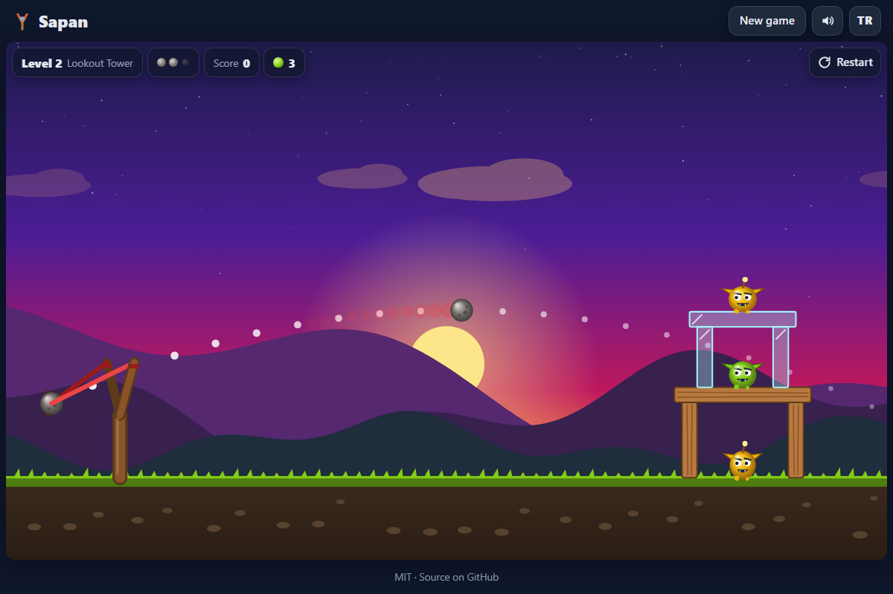

# Sapan - pull back the slingshot and bring down castles full of slime goblins

[](#tests)
[](LICENSE)

**▶ Play now: https://celaldrg.github.io/sapan/**



*Sapan* is Turkish for slingshot. Five crumbling castles of wood, glass and stone stand at dusk, and a band of slime goblins hides inside. You have a wooden slingshot and a few stones.

## Features

- Real 2D physics with [Matter.js](https://brm.io/matter-js/) 0.20.0 (vendored, MIT). Blocks and goblins take damage from how hard they are hit.
- Three materials that behave differently: light glass shatters, wood bends and snaps, heavy stone barely moves.
- Five handmade levels that get harder, each with 3 to 5 stones.
- A goblin is defeated when it is crushed, falls from its perch or is knocked out of the world.
- Earn 1 to 3 stars for the stones you still have. Winning a level unlocks the next one, and progress is saved in your browser.
- Dotted trajectory preview while you aim, debris, score pop-ups and synthesised sound effects (no audio files), with a mute button.
- English and Turkish interface. Mouse, touch and keyboard all work, and the game is fully playable on a 375 px wide phone.
- All art is drawn on the canvas at runtime: no images, no fonts, no external requests. Respects `prefers-reduced-motion`.

## How to play

Defeat every goblin in the level before you run out of stones.

| Action | Mouse / touch | Keyboard |
| --- | --- | --- |
| Aim | Press anywhere on the play area and drag back (away from the castle) | `↑` / `↓` angle, `←` / `→` power (hold `Shift` for big steps) |
| Fire | Release | `Space` or `Enter` |
| Cancel a shot | Release close to where you pressed | (just aim again) |
| Restart level | ↻ button | `R` |
| Level select | **New game** button | `Esc` or `L` |
| Sound on/off | Speaker button | `M` |

The farther you pull, the faster the stone flies. One stone flies at a time; the next one loads when the previous one has stopped or left the screen.

## Run locally

There is no build step. ES modules need to be served over `http://` (opening the file with `file://` does not work), so use any static server:

```sh
npx serve .
# or
python3 -m http.server 8000
```

Then open the printed address. Add `?demo` to the URL to see the frozen mid-game scene used for the screenshot above.

## Tests

```sh
node --test
```

Node 22 or newer, no dependencies to install. The suite runs headless Matter.js with a fixed timestep and a seeded random generator, so every run gives the same result. It covers:

- **Done criterion:** all 5 levels load, stand still for 5 simulated seconds with no shots (nothing breaks, falls or moves more than 5 px), and each level is won by toppling or destroying all its goblins with a stored shot sequence.
- Removing supports topples a goblin; knocking goblins out of the world counts as a defeat; running out of stones loses the level.
- One stone at a time, cancelled short pulls, clamped launch velocity, and a trajectory preview that matches the real flight.
- Stars and score, level unlocking, and cleaning up bad saved progress.
- Camera fitting in landscape and portrait, keyboard aiming, effects, the storage helper in private mode, and matching English and Turkish strings.

## Project structure

```text
index.html          page shell, meta tags, inline SVG favicon
style.css           dark theme, layout, HUD and overlays
src/
  levels.js         world size, materials, the five castles
  game.js           one level on a Matter.js engine: shots, damage, win/lose
  launch.js         drag clamping, launch velocity, trajectory preview
  rules.js          impact damage, stars, score bonus
  progress.js       unlocks and best results
  camera.js         fit a level to the screen, screen <-> world
  keyaim.js         keyboard aiming
  effects.js        debris, pop-ups, trail, shake (plain data)
  rng.js            seeded random generator
  i18n.js           English and Turkish strings
  storage.js        safe localStorage wrapper
  render.js         canvas drawing
  view.js           HUD, level picker, result card (DOM)
  audio.js          Web Audio sound effects
  main.js           wires everything together
test/               node:test suites
vendor/             matter.min.js 0.20.0 and its license
docs/screenshot.png
```

## License

[MIT](LICENSE) © 2026 Celalettin Durgaç. Matter.js is © Liam Brummitt and contributors, MIT licensed (see `vendor/matter-js-LICENSE.txt`).

---

## Türkçe

**Sapan:** sapanı geri çek, slime goblinlerle dolu kaleleri yık.

**▶ Hemen oyna: https://celaldrg.github.io/sapan/**

Alacakaranlıkta tahta, cam ve taştan yapılmış beş yıkık dökük kale var ve içlerinde bir slime goblin çetesi saklanıyor. Elinde tahta bir sapan ve birkaç taş var.

### Özellikler

- [Matter.js](https://brm.io/matter-js/) 0.20.0 ile gerçek 2B fizik (depoya eklendi, MIT). Bloklar ve goblinler aldıkları darbenin şiddetine göre hasar görür.
- Farklı davranan üç malzeme: hafif cam tuzla buz olur, tahta eğilip kırılır, ağır taş zor kıpırdar.
- Gittikçe zorlaşan, elle tasarlanmış beş bölüm. Her bölümde 3 ile 5 arası taş var.
- Goblin ezildiğinde, bulunduğu yerden düştüğünde ya da dünyanın dışına fırlatıldığında yenilir.
- Elinde kalan taşlara göre 1 ile 3 arası yıldız kazanırsın. Kazandığın bölüm bir sonrakinin kilidini açar ve ilerlemen tarayıcında saklanır.
- Nişan alırken noktalı yörünge önizlemesi, kırılma parçaları, puan yazıları ve ses dosyası kullanmadan üretilen ses efektleri. Sesi kapatma düğmesi de var.
- İngilizce ve Türkçe arayüz. Fare, dokunmatik ekran ve klavye ile oynanır, 375 px genişliğindeki telefonda da tam oynanabilir.
- Bütün çizimler oyun sırasında canvas üzerinde yapılır: resim, yazı tipi ya da dış istek yok. `prefers-reduced-motion` ayarına uyar.

### Nasıl oynanır

Taşların bitmeden bölümdeki bütün goblinleri yen.

| Eylem | Fare / dokunmatik | Klavye |
| --- | --- | --- |
| Nişan al | Oyun alanında herhangi bir yere bas ve geri (kaleden uzağa) sürükle | `↑` / `↓` açı, `←` / `→` güç (büyük adımlar için `Shift`) |
| At | Bırak | `Boşluk` ya da `Enter` |
| Atışı iptal et | Bastığın yere yakın bırak | (yeniden nişan al) |
| Bölümü yeniden başlat | ↻ düğmesi | `R` |
| Bölüm seçimi | **Yeni oyun** düğmesi | `Esc` ya da `L` |
| Ses aç/kapat | Hoparlör düğmesi | `M` |

Ne kadar çok çekersen taş o kadar hızlı uçar. Aynı anda tek taş uçar; önceki taş durunca ya da ekrandan çıkınca yenisi yerleşir.

### Yerelde çalıştırma

Derleme adımı yok. ES modülleri `http://` üzerinden sunulmalı (dosyayı `file://` ile açmak çalışmaz), bu yüzden herhangi bir statik sunucu kullan:

```sh
npx serve .
# ya da
python3 -m http.server 8000
```

Sonra yazdırılan adresi aç. Yukarıdaki ekran görüntüsündeki donmuş oyun anını görmek için adrese `?demo` ekle.

### Testler

```sh
node --test
```

Node 22 ya da daha yenisi yeterli, kurulacak bağımlılık yok. Testler Matter.js'i ekransız, sabit zaman adımı ve tohumlu rastgele sayı üreteciyle çalıştırır, yani her seferinde aynı sonuç çıkar. Kapsanan konular:

- **Bitti ölçütü:** 5 bölümün hepsi yüklenir, atış yapılmadan 5 simülasyon saniyesi boyunca ayakta kalır (hiçbir şey kırılmaz, düşmez ya da 5 px'ten fazla kaymaz) ve her bölüm, kayıtlı bir atış dizisiyle bütün goblinler devrilerek ya da yok edilerek kazanılır.
- Destekleri çekmek goblini devirir, goblini dünyanın dışına atmak yenilgi sayılır, taş bitince bölüm kaybedilir.
- Aynı anda tek taş, kısa çekişlerin iptali, sınırlanmış atış hızı ve gerçek uçuşla örtüşen yörünge önizlemesi.
- Yıldız ve puan, bölüm kilidi açma ve bozuk kayıtlı ilerlemenin temizlenmesi.
- Yatay ve dikey ekranda kamera sığdırma, klavyeyle nişan alma, efektler, gizli modda depolama yardımcısı ve İngilizce ile Türkçe metinlerin eşleşmesi.

### Lisans

[MIT](LICENSE) © 2026 Celalettin Durgaç. Matter.js © Liam Brummitt ve katkıda bulunanlar, MIT lisanslı (bkz. `vendor/matter-js-LICENSE.txt`).
